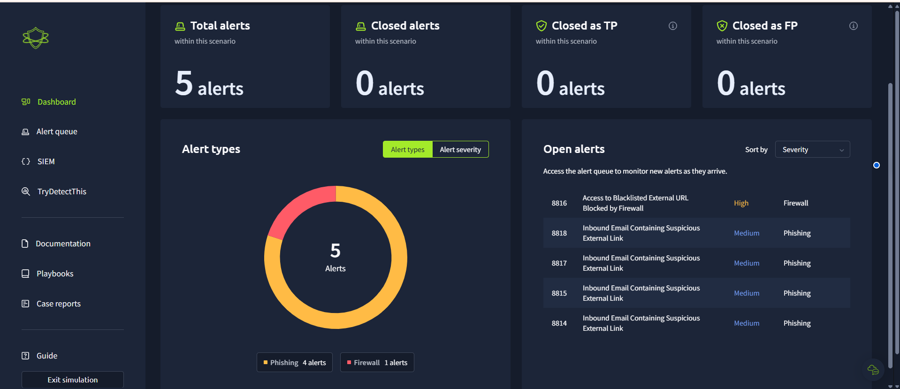
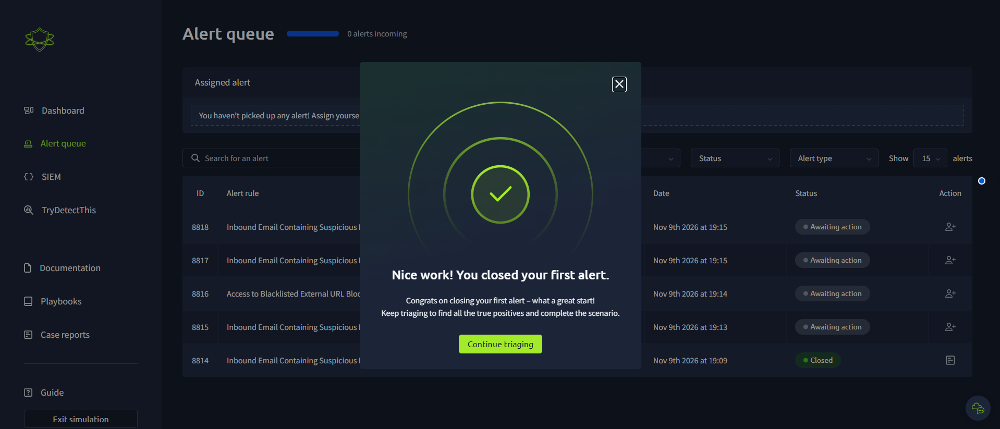
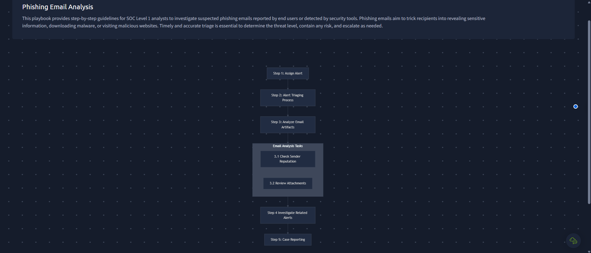
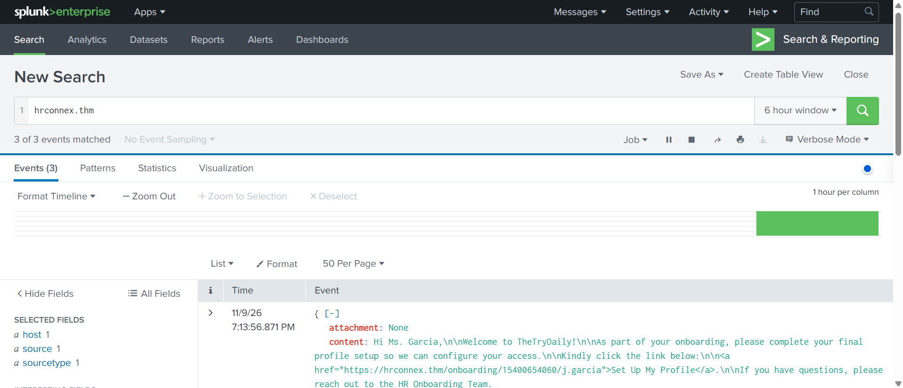
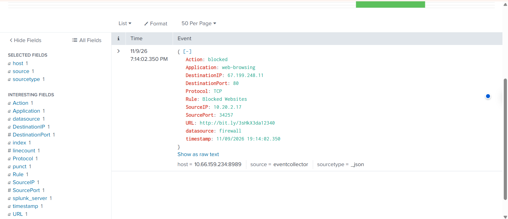
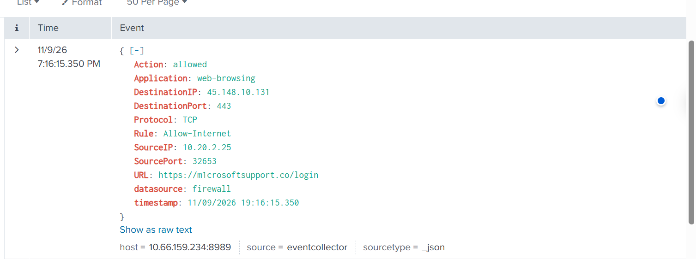
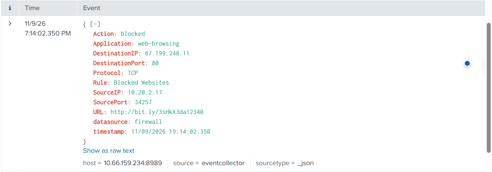

# SOC Alert Triage and Phishing Investigation

## Project Overview

I worked on this project to get practical experience with the daily responsibilities of a Security Operations Center (SOC) analyst. I used TryHackMe's SOC Simulator and Splunk SIEM to investigate 5 security alerts involving suspicious emails and network connections.

The simulation included five security alerts: four phishing-related alerts and one firewall alert. My task was to review the alerts, write out indicators of compromise (IoCs), determine whether the alert was either a true positive or a false positive, and document an incident response to close the alert - escalation if needed.

During the investigation, I reviewed email information including the sender and recipient, searched email and firewall logs in Splunk, checked suspicious IP addresses using TryDetectThis, and also examined firewall logs to understand whether network connections were allowed or blocked.

I also followed a phishing investigation playbook to guide my investigation and wrote an incidence report.

The main goal of this project was to improve my alert triage, log analysis, threat investigation, and incident reporting skills.

## Tools Used

- **TryHackMe SOC Simulator:** Used to review and investigate simulated security alerts.
- **Splunk Enterprise:** Used to search and analyze email and firewall logs.
- **TryDetectThis:** Used to check suspicious URLs, file hashes, and IP addresses.
- **Phishing Investigation Playbook:** Used as a guide for investigating suspicious emails.
- **Network Connection Investigation Playbook:** Used as a guide for investigating allowed or blocked connections.

## Investigation Environment

The SOC dashboard displayed five alerts:

- Four phishing-related alerts.
- One firewall alert involving a blocked connection.

The alerts had different severity levels, which helped me understand why SOC analysts need to prioritize investigations based on the potential risk.

## Investigation Process

### 1. Reviewing the Security Alerts

I took ownership of the alert that came in, displayed on the TryHackMe SOC Simulator dashboard. There were five alerts in total, including four phishing-related alerts and one firewall alert.

Before investigating, I read and understood the alert descriptions, severity levels, and ip addresses, suspicious link, email addresses, and other available information to understand what might have triggered each alert.

This helped me decide what evidence I needed to examine during the investigation.

### 2. Following the Phishing Investigation Playbook

For the phishing alerts, I used the phishing investigation playbook provided in the simulation.

The playbook helped me understand the steps involved in investigating a suspicious email. These included reviewing the sender's email address, checking the suspicious links in the email, and looking for evidence of suspicious network activity.

I learned that an email should not be classified as phishing simply because it contains an external link. It is important to investigate the sender, recipient, the purpose of the email, the subject of the email, domain of the email, and any related activity before making a decision.

### 3. Investigating an Email Using Splunk

One of the alerts involved an onboarding email sent from HRCONNEX, a third-party recruitment organization.

I used Splunk to search for information related to the email. During my investigation, I found an internal communication between the Human Resources department and IT Support confirming that HRCONNEX was involved in the employee onboarding process.

This evidence helped me understand that the email was expected rather than an unexpected phishing attempt.

Based on the available evidence, I classified the alert as a false positive.

### 4. Investigating a Blocked Firewall Connection

I also reviewed a firewall log involving a device with the source IP address `10.20.2.17`.

The device attempted to connect to the destination IP address `67.199.248.11` using TCP port 80.

After reviewing the firewall log in Splunk, I found that the connection had been blocked by a firewall rule named `Blocked Websites`.

This showed that the firewall had prevented the recorded connection from going through.

I also checked the destination IP using TryDetectThis, which identified it as malicious.

The investigation helped me understand how firewall logs and threat intelligence can be used together to investigate suspicious network connections.

### 5. Investigating an Allowed Firewall Connection

Another firewall log showed a connection from the source IP address `10.20.2.25` to the destination IP address `45.148.10.131` over TCP port 443.

Unlike the previous log, this connection was allowed by the firewall.

The event was associated with a suspicious Microsoft-themed URL.

This caught my attention because a connection being allowed does not automatically mean it is safe.

I learned that when investigating allowed connections, it is important to check the destination, review the related activity, and determine whether there is evidence of malicious behavior.

### 6. Checking Suspicious IP Addresses

As part of the investigation, I used TryDetectThis to check an IP address associated with suspicious network activity.

The tool flagged the IP address as malicious, which gave me additional information to consider alongside the firewall logs.

I learned that threat intelligence results can help analysts understand the potential risk of an IP address, but they should not be the only evidence used to make a final decision.

### 7. Closing the Security Alert

After investigating the alerts and reviewing the available evidence, I wrote incident reports explaining my findings and closed the alerts in the SOC Simulator.

For each alert, I had to decide whether it was a true positive or a false positive. I also considered whether the alert needed to be escalated to a senior SOC analyst, threat hunter, or incident response team.

I learned that false positives can usually be closed after confirming that the activity is legitimate. For true positives, the next action depends on the severity of the threat, the potential impact, and the organization's incident response procedures.

When writing my incident reports, I used the 5 W's to make sure my findings were clear:
- **Who:** The users, devices, or IP addresses involved.
- **What:** The suspicious activity that triggered the alert.
- **When:** The date and time the activity occurred.
- **Where:** Where the activity originated and where it was directed.
- **Why:** The possible reason behind the activity and what the available evidence suggested.
I also included the indicators of compromise (IOCs), the evidence I collected, and the reason for my final classification.

This helped me understand that SOC analysts must not only investigate security alerts but also explain their decisions clearly so other team members can understand what happened.

## Investigation Reports

I documented my findings in a separate investigation report. The report explains the alerts I investigated, the evidence I collected, and the reasons behind my final decisions.

[Read My SOC Alert Triage Investigation Report](investigations/alert-triage-summary.md)

## Lessons Learned

This project helped me understand how SOC analysts investigate security alerts in a real security environment.

One of the biggest things I learned was that not every security alert means an attack has happened. During the HRCONNEX email investigation, I initially had to treat the email as suspicious because it contained an external link. However, after searching Splunk and reviewing the internal communication between HR and IT, I found evidence that the email was part of a legitimate onboarding process.

I also learned how important firewall logs are during an investigation. I examined one connection that was blocked and another that was allowed. This taught me that even when a firewall allows a connection, it does not automatically mean the activity is safe.

Another important lesson was how to write incident reports. I practiced explaining what happened, identifying the systems involved, and supporting my conclusions with evidence instead of assumptions.

I still want to improve my Splunk Search Processing Language (SPL) skills, especially when it comes to correlating events across different data sources and investigating more complicated attacks.

Overall, this project gave me more confidence in investigating security alerts and helped me understand the responsibilities of a Level 1 SOC analyst.
